# Manual de usuario — Compras y Proveedores

**Sistema:** Restaurante Orígenes SV

**Módulo:** Compras y Proveedores

**Versión del manual:** 1.0

**Fecha:** Noviembre de 2026

## 1. Introducción

El módulo de Compras y Proveedores forma parte del sistema de gestión
del Restaurante Orígenes SV. Su propósito es facilitar la administración
de proveedores, el registro de facturas de compra y la consulta de
obligaciones pendientes de pago.

El módulo incorpora alertas preventivas que ayudan al usuario a tomar
decisiones relacionadas con el abastecimiento de insumos, los costos
de adquisición y los vencimientos de facturas.

## 2. Objetivo del manual

Proporcionar instrucciones claras para utilizar las funcionalidades
del módulo de Compras y Proveedores, desde el registro de un proveedor
hasta la consulta de las cuentas pendientes de pago.

## 3. Requisitos de acceso

Para utilizar el módulo se requiere:

- Una computadora, tableta o dispositivo móvil.
- Un navegador web actualizado.
- Acceso a la aplicación en ejecución.
- Disponibilidad del frontend del sistema.

Durante las pruebas locales, la aplicación se encuentra disponible en:

http://127.0.0.1:5173

Actualmente, el módulo puede utilizarse en modo de demostración,
lo que permite evaluar sus funcionalidades mediante datos simulados
sin depender de una conexión activa con la base de datos.

## 4. Navegación general

El sistema dispone de una barra de navegación superior identificada
con el nombre Orígenes SV.

Desde esta barra se puede acceder a los siguientes módulos:

| Módulo | Descripción |
|---|---|
| POS | Punto de venta del restaurante. |
| Inventario | Gestión de insumos y existencias. |
| Compras | Gestión de proveedores y compras. |
| Caja | Gestión de operaciones de caja. |
| RRHH | Gestión de recursos humanos. |

Para acceder al módulo de Compras:

1. Abrir la aplicación en el navegador.
2. Localizar la barra de navegación superior.
3. Seleccionar la opción Compras.
4. Verificar que se muestra el encabezado Compras y proveedores.

La opción correspondiente al módulo activo se resalta visualmente
para facilitar la orientación del usuario.

En dispositivos móviles, las opciones de navegación se encuentran
dentro de un menú desplegable que puede abrirse y cerrarse mediante
el botón ubicado en la barra superior.

### 4.1. Indicadores generales

La barra de navegación presenta dos indicadores informativos:

- Caja: muestra el estado actual de la caja.
- Alertas de stock: muestra la cantidad de insumos que requieren
  atención según sus existencias y niveles mínimos.

Los indicadores solicitan una actualización al cambiar de módulo
y periódicamente cada 30 segundos.

Si la información no está disponible, el sistema muestra mensajes
que permiten identificar problemas de conexión o carga de datos.

En el modo de demostración, estos indicadores utilizan datos simulados.

## 5. Descripción del módulo de Compras

El módulo se identifica mediante el encabezado Compras y proveedores
y presenta cuatro pestañas principales.

| Pestaña | Funcionalidad |
|---|---|
| Proveedores | Consultar, registrar y editar proveedores. |
| Nueva compra | Registrar facturas y consultar alertas preventivas de compra. |
| Historial de compras | Consultar y filtrar las compras registradas. |
| Cuentas por pagar | Consultar obligaciones pendientes y vencimientos. |

Al ingresar al módulo, la pestaña Proveedores se encuentra
seleccionada de manera predeterminada.

Para cambiar de funcionalidad, el usuario debe seleccionar
la pestaña correspondiente. El contenido se actualiza sin
recargar completamente la página.

Las funcionalidades disponibles permiten gestionar el proceso
de compra desde la identificación del proveedor hasta la
consulta de las obligaciones pendientes de pago.

## 6. Gestión de proveedores

La gestión de proveedores permite administrar la información
de las empresas que suministran insumos al restaurante.

### 6.1. Consultar proveedores

1. Acceder al módulo Compras desde la barra de navegación.
2. Seleccionar la pestaña Proveedores.
3. Localizar la sección Listado de proveedores.

La tabla presenta la siguiente información:

| Columna | Descripción |
|---|---|
| Compañía | Nombre de la empresa proveedora. |
| Contacto | Nombre de la persona de contacto. |
| Correo electrónico | Dirección de correo del proveedor. |
| Teléfono | Número telefónico de contacto. |
| Dirección | Ubicación del proveedor. |
| Estado | Indica si el proveedor está activo o inactivo. |
| Acciones | Permite editar la información del proveedor. |

Los proveedores activos se identifican mediante una etiqueta
verde y los inactivos mediante una etiqueta gris.

Si no existen registros, el sistema muestra el mensaje
No hay proveedores registrados.

### 6.2. Registrar un proveedor

Para registrar un nuevo proveedor:

1. Seleccionar la pestaña Proveedores.
2. Presionar el botón + Nuevo proveedor.
3. Completar los campos del formulario Registrar proveedor.
4. Verificar la información ingresada.
5. Presionar el botón Registrar proveedor.

El formulario contiene los siguientes campos:

| Campo | Obligatorio | Restricción |
|---|---|---|
| Compañía | Sí | Máximo 50 caracteres. |
| Nombre del contacto | Sí | Máximo 50 caracteres. |
| Correo electrónico | Sí | Formato válido y máximo 50 caracteres. |
| Teléfono | No | 8 dígitos si se proporciona. |
| Dirección | No | Máximo 100 caracteres. |
| Proveedor activo | No | Activado de manera predeterminada. |

Los campos identificados con un asterisco son obligatorios.

Ejemplo de registro:

| Campo | Valor de ejemplo |
|---|---|
| Compañía | Distribuidora Central |
| Nombre del contacto | Carlos Pérez |
| Correo electrónico | distribuidora@example.com |
| Teléfono | 77771234 |
| Dirección | San Salvador |
| Proveedor activo | Sí |

Si el registro se realiza correctamente, el sistema muestra
el mensaje Proveedor registrado correctamente.

Si existen datos incorrectos, el formulario muestra los
mensajes correspondientes para que el usuario pueda corregirlos.

El botón Cancelar permite cerrar el formulario sin guardar
los cambios, siempre que no exista una operación de guardado
en proceso.

### 6.3. Editar un proveedor

Para modificar la información de un proveedor:

1. Localizar el proveedor en el listado.
2. Presionar el botón Editar.
3. Modificar los campos necesarios.
4. Verificar la información actualizada.
5. Presionar el botón Actualizar proveedor.

El formulario presenta los datos actuales del proveedor,
permitiendo modificar únicamente la información necesaria.

Cuando la actualización se realiza correctamente, el sistema
muestra el mensaje Proveedor actualizado correctamente.

### 6.4. Cambiar el estado de un proveedor

El sistema permite activar o desactivar proveedores sin
eliminar sus registros.

Para cambiar el estado:

1. Localizar el proveedor en el listado.
2. Presionar el botón Editar.
3. Localizar la casilla Proveedor activo.
4. Marcar la casilla para activar al proveedor o desmarcarla
   para desactivarlo.
5. Presionar el botón Actualizar proveedor.

Los proveedores inactivos permanecen visibles en el listado,
pero no deben utilizarse para registrar nuevas compras.

Esta funcionalidad permite conservar la información del
proveedor sin eliminar su registro.

En el modo de demostración, los cambios se mantienen durante
la ejecución de la aplicación y pueden perderse al recargar
completamente la página.

## 7. Registro de compras

La pestaña Nueva compra permite registrar las facturas correspondientes a la adquisición de insumos para el restaurante. El sistema calcula automáticamente los importes de la compra, aplica el IVA y determina el estado de pago según la condición seleccionada.

Para acceder a esta funcionalidad:

1. Ingresar al módulo Compras.
2. Seleccionar la pestaña Nueva compra.
3. Completar el formulario Registro de compra.

### 7.1. Datos de la factura

En la sección Datos de la factura se deben completar los siguientes campos:

| Campo | Descripción | Obligatorio |
|---|---|---|
| Proveedor | Proveedor responsable del suministro de insumos. | Sí |
| Número de factura | Identificador del documento de compra. | Sí |
| Fecha de compra | Fecha correspondiente a la adquisición. | Sí |
| Condición de pago | Permite seleccionar Contado o Crédito. | Sí |
| Fecha límite de pago | Fecha máxima establecida para pagar la factura. | Solo para compras al crédito |

El sistema muestra únicamente los proveedores activos en el listado de selección.

La fecha de compra se establece inicialmente con la fecha actual del dispositivo y la condición de pago predeterminada es Contado.

### 7.2. Selección de insumos

La sección Detalle de compra permite especificar los insumos adquiridos.

Para agregar un insumo:

1. Localizar la tabla Detalle de compra.
2. Seleccionar un insumo en el campo correspondiente.
3. Ingresar la cantidad de paquetes.
4. Indicar la cantidad de unidades por paquete.
5. Introducir el costo por paquete.
6. Presionar el botón + Agregar insumo si se necesita incorporar otro producto.

Cada insumo muestra su nombre y unidad de medida.

El sistema evita seleccionar un mismo insumo en diferentes filas. Además, limita la cantidad de filas a la cantidad de insumos disponibles.

Para eliminar una fila, presionar el botón Eliminar. El formulario debe conservar como mínimo una fila de detalle.

### 7.3. Cantidades y costos

La tabla de detalle contiene las siguientes columnas:

| Columna | Descripción |
|---|---|
| Insumo | Producto o materia prima adquirida. |
| Paquetes | Cantidad de paquetes comprados. |
| Cantidad por paquete (unidad del insumo) | Cantidad contenida en cada paquete, expresada en la unidad del insumo. |
| Costo por paquete | Precio de adquisición de cada paquete. |
| Subtotal | Importe correspondiente a la fila. |
| Acción | Permite eliminar una fila del detalle. |

Las cantidades de paquetes y unidades por paquete deben ser números enteros positivos.

El costo por paquete debe ser mayor que cero y contener como máximo dos decimales.

La cantidad total adquirida se determina mediante la siguiente fórmula:

**Cantidad adquirida = Paquetes × Unidades por paquete**

Por ejemplo, si se compran 5 paquetes de maíz y cada paquete contiene 10 libras, la cantidad adquirida corresponde a 50 libras.

### 7.4. Cálculo del subtotal, IVA y total

El sistema realiza automáticamente los cálculos monetarios conforme se modifican las cantidades y los costos.

Las fórmulas utilizadas son:

- Subtotal por insumo = Cantidad de paquetes × Costo por paquete.
- Subtotal de compra = Suma de los subtotales de todos los insumos.
- IVA = Subtotal de compra × 0.13.
- Total de compra = Subtotal de compra + IVA.

Los importes monetarios se redondean a dos decimales y se presentan en dólares estadounidenses.

Ejemplo de cálculo:

| Insumo | Paquetes | Unidades por paquete | Costo por paquete | Subtotal |
|---|---:|---:|---:|---:|
| Maíz | 5 | 10 | $8.00 | $40.00 |
| Quesillo | 2 | 5 | $10.00 | $20.00 |

| Concepto | Importe |
|---|---:|
| Subtotal | $60.00 |
| IVA (13 %) | $7.80 |
| Total | $67.80 |

La sección Resumen de compra presenta los importes calculados, la condición de pago, el estado de pago y el saldo pendiente.

### 7.5. Confirmación de la compra

Antes de registrar una compra, el usuario debe verificar que los datos de la factura, las cantidades y los costos sean correctos.

Para confirmar el registro:

1. Revisar los datos de la factura.
2. Verificar los insumos y sus cantidades.
3. Consultar las alertas preventivas, cuando estén disponibles.
4. Revisar el subtotal, IVA y total.
5. Presionar el botón Registrar compra.
6. Esperar el resultado de la operación.

Durante el procesamiento, el botón muestra el texto Registrando... y permanece deshabilitado para evitar envíos repetidos.

Si la operación finaliza correctamente, el sistema muestra un mensaje de confirmación que incluye el número de factura y el total registrado.

Ejemplo:

> Compra FAC-DEMO-001 registrada correctamente. Total: $67.80.

Después de un registro exitoso, el formulario se restablece para permitir una nueva compra.

Si existen datos incorrectos, el sistema presenta un listado de errores bajo el mensaje Corrige los siguientes errores.

Si ocurre un error durante el registro, se muestra el mensaje correspondiente y se conservan los datos ingresados para que el usuario pueda corregirlos o intentar nuevamente.

Las alertas preventivas son recomendaciones y no impiden registrar una compra que cumple las validaciones obligatorias.

En el modo de demostración, las compras se registran utilizando datos simulados. Esto no representa una actualización real de la base de datos ni de las existencias del inventario.

## 8. Compras al contado y al crédito

El sistema permite registrar compras mediante dos condiciones de pago: Contado y Crédito.

La condición seleccionada determina el estado inicial de pago y el saldo pendiente de la factura.

### 8.1. Compras al contado

Una compra al contado se registra como pagada desde el momento de su confirmación.

Para registrar una compra al contado:

1. Completar los datos de la factura.
2. Seleccionar Contado en Condición de pago.
3. Agregar los insumos adquiridos.
4. Revisar el resumen.
5. Presionar Registrar compra.

El sistema establece automáticamente:

- Condición de pago: Contado.
- Estado de pago: Pagada.
- Saldo pendiente: $0.00.

No se solicita una fecha límite de pago para esta modalidad.

### 8.2. Compras al crédito

Una compra al crédito representa una obligación de pago pendiente con el proveedor.

Para registrar una compra al crédito:

1. Completar los datos de la factura.
2. Seleccionar Crédito en Condición de pago.
3. Ingresar la Fecha límite de pago.
4. Agregar los insumos adquiridos.
5. Revisar el resumen.
6. Presionar Registrar compra.

La fecha límite de pago es obligatoria y no puede ser anterior a la fecha de compra.

El sistema establece automáticamente:

- Condición de pago: Crédito.
- Estado de pago: Pendiente de pago.
- Saldo pendiente: Total de la compra.

Las compras al crédito pendientes pueden consultarse posteriormente en la pestaña Cuentas por pagar.

### 8.3. Comparación entre condiciones de pago

Tomando como ejemplo una compra de $67.80:

| Característica | Contado | Crédito |
|---|---|---|
| Total de compra | $67.80 | $67.80 |
| Estado inicial | Pagada | Pendiente de pago |
| Saldo pendiente | $0.00 | $67.80 |
| Fecha límite obligatoria | No | Sí |
| Genera una cuenta pendiente | No | Sí |

Si el usuario cambia la condición de Crédito a Contado antes de registrar la compra, el sistema elimina automáticamente la fecha límite ingresada.

Actualmente, el módulo permite consultar las obligaciones pendientes, pero no registrar abonos parciales ni procesar pagos reales a proveedores.
## 9. Historial de compras

La pestaña Historial de compras permite consultar las compras registradas en el sistema, independientemente de su condición y estado de pago.

Para consultar el historial:

1. Ingresar al módulo Compras.
2. Seleccionar la pestaña Historial de compras.
3. Esperar la carga de los registros.
4. Consultar la información presentada en la tabla.

### 9.1. Información del historial

La tabla presenta las siguientes columnas:

| Columna | Descripción |
|---|---|
| Fecha | Fecha en la que se realizó la compra. |
| Proveedor | Nombre de la compañía proveedora. |
| Número de factura | Identificador de la factura registrada. |
| Total | Importe total de la compra, incluyendo IVA. |
| Condición de pago | Indica si la compra fue realizada al contado o al crédito. |
| Estado de pago | Indica si la factura está pagada o pendiente de pago. |

Los importes se presentan en dólares estadounidenses.

### 9.2. Filtro por proveedor

El sistema permite consultar las compras correspondientes a un proveedor específico.

Para utilizar este filtro:

1. Localizar el campo Filtrar por proveedor.
2. Desplegar las opciones disponibles.
3. Seleccionar el proveedor que se desea consultar.
4. Revisar los resultados de la tabla.

El filtro presenta los proveedores que tienen compras registradas en el historial.

Para volver a visualizar las compras de todos los proveedores, seleccionar Todos los proveedores.

### 9.3. Filtro por estado de pago

El campo Filtrar por estado de pago contiene las siguientes opciones:

| Opción | Resultado |
|---|---|
| Todos los estados | Muestra las compras sin distinguir su estado de pago. |
| Pagadas | Muestra únicamente las facturas pagadas. |
| Pendientes de pago | Muestra únicamente las facturas que presentan una obligación pendiente. |

Los filtros por proveedor y estado de pago pueden utilizarse simultáneamente.

Por ejemplo, el usuario puede seleccionar un proveedor específico y la opción Pendientes de pago para consultar únicamente las facturas pendientes correspondientes a dicho proveedor.

### 9.4. Identificación visual de los registros

El sistema utiliza etiquetas de colores para facilitar la identificación de las condiciones y estados de pago.

| Etiqueta | Color |
|---|---|
| Contado | Azul |
| Crédito | Celeste |
| Pagada | Verde |
| Pendiente de pago | Amarillo |

### 9.5. Resultados y mensajes del sistema

Durante la consulta de información, el sistema presenta el mensaje Cargando compras...

Si no existen compras registradas o ninguna coincide con los filtros seleccionados, se presenta el mensaje:

> No se encontraron compras.

Si ocurre un error durante la consulta, el sistema muestra un mensaje de error.

El historial funciona como una herramienta de consulta. Actualmente no permite editar, eliminar ni anular compras registradas desde esta pantalla.

## 10. Cuentas por pagar

La pestaña Cuentas por pagar permite consultar las obligaciones pendientes con los proveedores y conocer el estado de vencimiento de las facturas.

Para acceder a esta funcionalidad:

1. Ingresar al módulo Compras.
2. Seleccionar la pestaña Cuentas por pagar.
3. Esperar la carga de la información.
4. Revisar los indicadores financieros y el listado de facturas pendientes.

### 10.1. Indicadores financieros

En la parte superior de la pantalla se presentan tres indicadores:

| Indicador | Descripción |
|---|---|
| Deuda total con proveedores | Suma de los saldos pendientes de todas las facturas no pagadas. |
| Facturas pendientes | Cantidad total de facturas que todavía no han sido pagadas, incluyendo las vencidas. |
| Facturas vencidas | Cantidad de facturas pendientes cuya fecha límite de pago es anterior a la fecha actual. |

Las fórmulas utilizadas son:

- Deuda total = Suma de los saldos pendientes.
- Facturas pendientes = Cantidad de facturas no pagadas.
- Facturas vencidas = Cantidad de facturas no pagadas cuya fecha límite es anterior a la fecha actual.

Ejemplo:

| Factura | Total | Estado |
|---|---:|---|
| FAC-001 | $45.20 | Pagada |
| FAC-002 | $113.00 | Pendiente de pago |
| FAC-003 | $67.80 | Vencida |

Los indicadores correspondientes serían:

| Indicador | Resultado |
|---|---:|
| Deuda total con proveedores | $180.80 |
| Facturas pendientes | 2 |
| Facturas vencidas | 1 |

Los valores anteriores corresponden a un ejemplo ilustrativo.

### 10.2. Facturas pendientes

La tabla de cuentas por pagar presenta únicamente las compras que no han sido pagadas.

Las columnas disponibles son:

| Columna | Descripción |
|---|---|
| Proveedor | Nombre del proveedor al que corresponde la obligación. |
| Número de factura | Identificador de la factura pendiente. |
| Fecha de compra | Fecha en la que se registró la adquisición. |
| Fecha límite de pago | Fecha máxima establecida para realizar el pago. |
| Total de factura | Importe total de la compra. |
| Saldo pendiente | Importe que permanece pendiente de pago. |
| Estado | Indica si la factura está pendiente de pago o vencida. |

En la implementación actual, el saldo pendiente de una factura no pagada corresponde al importe total de la compra, debido a que todavía no se gestionan abonos parciales.

Las compras pagadas no aparecen en esta tabla.

Si no existen obligaciones pendientes, el sistema presenta el mensaje:

> No hay cuentas pendientes de pago.

### 10.3. Facturas vencidas

Una factura se considera vencida cuando cumple las siguientes condiciones:

- No ha sido pagada.
- Tiene una fecha límite de pago establecida.
- Su fecha límite de pago es anterior a la fecha actual.

El sistema utiliza la fecha actual del dispositivo para determinar el vencimiento.

Los estados se identifican mediante las siguientes etiquetas:

| Estado | Color | Significado |
|---|---|---|
| Pendiente de pago | Amarillo | La factura no ha sido pagada y todavía no se considera vencida. |
| Vencida | Rojo | La fecha límite de pago ya ha transcurrido y la factura continúa sin pagarse. |

Una factura cuya fecha límite corresponde al día actual todavía no se considera vencida. Sin embargo, el sistema presenta una alerta preventiva para informar que debe pagarse ese día.

Las alertas de próximos vencimientos se describen en la sección 11.5 de este manual.

La funcionalidad de cuentas por pagar es actualmente informativa. No permite realizar transferencias, registrar abonos parciales ni procesar pagos reales a proveedores.

## 11. Alertas preventivas

El módulo de compras incorpora alertas preventivas que permiten apoyar la toma de decisiones durante el abastecimiento de insumos y la gestión de obligaciones financieras del restaurante.

Estas funcionalidades analizan las cantidades ingresadas, las existencias disponibles, los costos históricos y las fechas límite de pago.

Las alertas son informativas y no sustituyen las decisiones del responsable de compras.

### 11.1. Posible exceso de inventario

Esta alerta aparece cuando la cantidad adquirida provocaría que las existencias proyectadas superen tres veces el stock mínimo establecido para el insumo.

Fórmulas utilizadas:

- Cantidad adquirida = Paquetes × Unidades por paquete.
- Stock proyectado = Stock actual + Cantidad adquirida.
- Umbral preventivo = Stock mínimo × 3.

Ejemplo:

| Concepto | Cantidad |
|---|---:|
| Insumo | Maíz |
| Stock actual | 25 libras |
| Stock mínimo | 8 libras |
| Paquetes adquiridos | 5 |
| Libras por paquete | 10 |
| Cantidad adquirida | 50 libras |
| Stock proyectado | 75 libras |
| Umbral preventivo | 24 libras |

Como las existencias proyectadas superan el umbral preventivo, el sistema muestra una advertencia amarilla.

El usuario debe evaluar si la cantidad solicitada es necesaria antes de registrar la compra.

Esta advertencia no impide completar el registro.

### 11.2. Abastecimiento insuficiente

Esta alerta aparece cuando las existencias proyectadas después de una compra continúan por debajo del stock mínimo.

Ejemplo ilustrativo:

| Concepto | Cantidad |
|---|---:|
| Stock actual | 2 libras |
| Stock mínimo | 8 libras |
| Cantidad adquirida | 3 libras |
| Stock proyectado | 5 libras |
| Cantidad faltante después de la compra | 3 libras |

El sistema muestra una advertencia amarilla indicando que el abastecimiento planificado no es suficiente para alcanzar las existencias mínimas.

El usuario puede modificar las cantidades antes de confirmar la compra.

### 11.3. Cantidad recomendada de compra

Cuando las existencias actuales de un insumo son inferiores al stock mínimo, el sistema calcula una cantidad recomendada de abastecimiento.

Fórmulas utilizadas:

- Cantidad faltante = Máximo entre cero y la diferencia del stock mínimo menos el stock actual.
- Paquetes recomendados = Cantidad faltante dividida entre las unidades por paquete, redondeada hacia arriba.
- Cantidad recomendada = Paquetes recomendados × Unidades por paquete.

Ejemplo ilustrativo:

| Concepto | Cantidad |
|---|---:|
| Stock actual | 2 libras |
| Stock mínimo | 8 libras |
| Cantidad faltante | 6 libras |
| Libras por paquete | 4 |
| Paquetes recomendados | 2 |
| Cantidad recomendada | 8 libras |

El sistema recomienda adquirir al menos dos paquetes para alcanzar o superar el stock mínimo.

Esta recomendación se presenta mediante una alerta informativa de color celeste.

La cantidad recomendada no se introduce automáticamente en el formulario. El usuario conserva el control sobre las cantidades adquiridas.

### 11.4. Incremento de precios

El sistema compara el costo unitario del insumo que se desea adquirir con el costo unitario de la última compra comparable.

Para realizar la comparación se consideran los siguientes criterios:

- Mismo proveedor.
- Mismo insumo.
- Misma sucursal.
- Compra previamente registrada.
- Fecha anterior o igual a la fecha de la nueva compra.

Fórmulas utilizadas:

- Costo unitario = Costo por paquete / Unidades por paquete.
- Incremento porcentual = ((Costo unitario actual - Costo unitario anterior) / Costo unitario anterior) × 100.

La advertencia aparece cuando el incremento es igual o superior al 10 %.

Ejemplo:

| Concepto | Compra anterior | Compra actual |
|---|---:|---:|
| Unidades por paquete | 10 | 10 |
| Costo por paquete | $8.00 | $8.80 |
| Costo unitario | $0.80 | $0.88 |

Incremento porcentual:

(($0.88 - $0.80) / $0.80) × 100 = 10 %.

El sistema presenta una advertencia amarilla que incluye el porcentaje de incremento, los costos unitarios y la factura utilizada como referencia.

Los costos comparados corresponden a los importes antes del IVA.

Si no existe una compra histórica comparable, no se genera una advertencia de incremento de precio.

Si ocurre un error al consultar el historial de precios, el sistema informa que estas alertas no están disponibles y permite continuar con el registro.

### 11.5. Próximos vencimientos

La pestaña Cuentas por pagar incluye alertas para identificar las facturas pendientes cuya fecha límite se encuentra entre el día actual y los próximos siete días naturales.

| Días restantes | Clasificación |
|---|---|
| 0 días | Alerta roja: Factura vence hoy. |
| Entre 1 y 7 días | Alerta amarilla: Próximo vencimiento. |
| Más de 7 días | No genera alerta preventiva. |
| Menos de 0 días | Factura vencida en la tabla de cuentas por pagar. |

Cada alerta presenta el nombre del proveedor, número de factura, fecha límite de pago, saldo pendiente y días restantes.

Las alertas se ordenan de menor a mayor cantidad de días restantes, priorizando las obligaciones más próximas.

Las facturas pagadas no generan alertas de vencimiento.

### 11.6. Consideraciones generales

| Parámetro | Valor |
|---|---:|
| Factor de exceso de inventario | 3 |
| Incremento de precio | 10 % |
| Anticipación de vencimientos | 7 días |

Estos valores corresponden a una configuración inicial y pueden ajustarse mediante modificaciones en la configuración técnica del sistema.

Las alertas se basan en reglas de negocio deterministas y no utilizan modelos de inteligencia artificial.

La detección de posibles compras duplicadas mediante órdenes pendientes de recepción todavía no se encuentra implementada.

## 12. Validaciones y mensajes del sistema

### 12.1. Validaciones de proveedores

| Campo | Validación |
|---|---|
| Compañía | Obligatorio, máximo 50 caracteres. |
| Nombre del contacto | Obligatorio, máximo 50 caracteres. |
| Correo electrónico | Obligatorio, formato válido y máximo 50 caracteres. |
| Teléfono | Opcional; si se proporciona, debe contener ocho dígitos. |
| Dirección | Opcional, máximo 100 caracteres. |
| Estado | Permite identificar proveedores activos e inactivos. |

El sistema simulado también verifica que el correo electrónico no se encuentre registrado para otro proveedor.

### 12.2. Validaciones de compras

| Campo o condición | Validación |
|---|---|
| Proveedor | Debe existir y encontrarse activo. |
| Número de factura | Obligatorio. |
| Fecha de compra | Obligatoria. |
| Condición de pago | Contado o Crédito. |
| Fecha límite de pago | Obligatoria para compras al crédito. |
| Vencimiento | No puede ser anterior a la fecha de compra. |
| Detalle de compra | Debe contener al menos un insumo. |
| Insumo | Debe existir en el catálogo disponible. |
| Cantidad de paquetes | Número entero positivo. |
| Unidades por paquete | Número entero positivo. |
| Costo por paquete | Mayor que cero y máximo dos decimales. |
| Insumos duplicados | No se permite repetir un insumo. |
| Total | Debe ser un importe finito y mayor que cero. |

El sistema simulado también verifica que no exista otra factura con el mismo número para el mismo proveedor.

### 12.3. Mensajes del sistema

| Tipo de mensaje | Color | Finalidad |
|---|---|---|
| Éxito | Verde | Confirmar una operación realizada correctamente. |
| Error | Rojo | Informar sobre errores de validación o procesamiento. |
| Advertencia | Amarillo | Informar sobre posibles riesgos. |
| Información | Celeste | Presentar recomendaciones de apoyo. |

Las validaciones obligatorias deben corregirse antes de registrar una compra. Las advertencias preventivas no bloquean el registro.

### 12.4. Estados de procesamiento

Durante las consultas y operaciones de registro, el sistema presenta indicadores de carga y mensajes de procesamiento.

Los botones de registro permanecen deshabilitados mientras se procesa el envío correspondiente, con el objetivo de evitar solicitudes repetidas.
## 13. Ejemplo práctico de utilización

El siguiente ejemplo describe el proceso completo de registro y consulta de una compra al crédito en el modo de demostración.

### 13.1. Registrar un proveedor

Ingresar a la pestaña Proveedores y presionar + Nuevo proveedor.

| Campo | Valor |
|---|---|
| Compañía | Distribuidora Central |
| Nombre del contacto | Carlos Pérez |
| Correo electrónico | distribuidora@example.com |
| Teléfono | 77771234 |
| Dirección | San Salvador |
| Proveedor activo | Sí |

Presionar Registrar proveedor y verificar el mensaje de confirmación.

Si el proveedor ya existe, puede utilizarse el registro existente.

### 13.2. Registrar una factura

Ingresar a la pestaña Nueva compra y completar los siguientes datos:

| Campo | Valor |
|---|---|
| Proveedor | Distribuidora Central |
| Número de factura | FAC-DEMO-001 |
| Fecha de compra | Fecha actual |
| Condición de pago | Crédito |
| Fecha límite de pago | Cinco días después de la fecha de compra |

Agregar los siguientes insumos:

| Insumo | Paquetes | Unidades por paquete | Costo por paquete |
|---|---:|---:|---:|
| Maíz | 5 | 10 | $8.00 |
| Quesillo | 2 | 5 | $10.00 |

### 13.3. Revisar los resultados

| Concepto | Resultado esperado |
|---|---:|
| Subtotal | $60.00 |
| IVA (13 %) | $7.80 |
| Total | $67.80 |
| Condición de pago | Crédito |
| Estado de pago | Pendiente de pago |
| Saldo pendiente | $67.80 |

Revisar las alertas preventivas, presionar Registrar compra y verificar el mensaje de éxito.

Si el número de factura ya existe para el proveedor seleccionado, utilizar un número diferente.

### 13.4. Consultar el historial

Ingresar a Historial de compras.

Seleccionar Distribuidora Central en el filtro por proveedor y Pendientes de pago en el filtro por estado.

Verificar que la factura registrada aparezca con un total de $67.80.

### 13.5. Consultar cuentas por pagar

Ingresar a Cuentas por pagar y verificar que la factura aparezca en la tabla de obligaciones pendientes.

La deuda total debe aumentar $67.80 respecto al valor existente antes del registro.

La cantidad de facturas pendientes debe aumentar en una unidad.

Como la fecha límite corresponde a los próximos cinco días, debe aparecer una alerta preventiva de vencimiento.

## 14. Limitaciones actuales

1. Los proveedores, insumos y compras utilizan datos simulados en el modo de demostración.
2. Los cambios realizados no cuentan con persistencia permanente.
3. Al recargar completamente la aplicación, los datos simulados pueden restablecerse.
4. El registro de compras todavía no actualiza las existencias reales del inventario.
5. La integración con la base de datos depende de los servicios disponibles en el backend.
6. La sucursal utilizada corresponde provisionalmente al identificador 1.
7. No se encuentra disponible el registro de abonos parciales.
8. No se procesan pagos reales a proveedores.
9. No se permite editar, eliminar ni anular compras desde el historial.
10. La detección de órdenes de compra pendientes de recepción continúa pendiente.
11. El umbral preventivo de exceso no representa una capacidad máxima real de almacenamiento.
12. Las recomendaciones no consideran predicciones de demanda futura.
13. Las alertas de vencimiento no generan notificaciones externas.
14. Los vencimientos no se actualizan automáticamente al cambiar de día sin una nueva evaluación de la pantalla.

La versión actual permite demostrar las funcionalidades del frontend y verificar sus reglas de negocio, sin afirmar que existe una operación financiera o de inventario completamente integrada con la base de datos.

## 15. Capturas y evidencias

Las siguientes evidencias muestran las funcionalidades del módulo de compras y proveedores durante su ejecución en el entorno de demostración.

### 15.1. Listado de proveedores

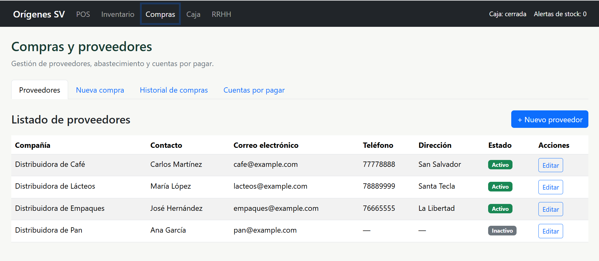

Figura 1. Consulta de proveedores registrados y sus estados.

### 15.2. Registro de proveedores

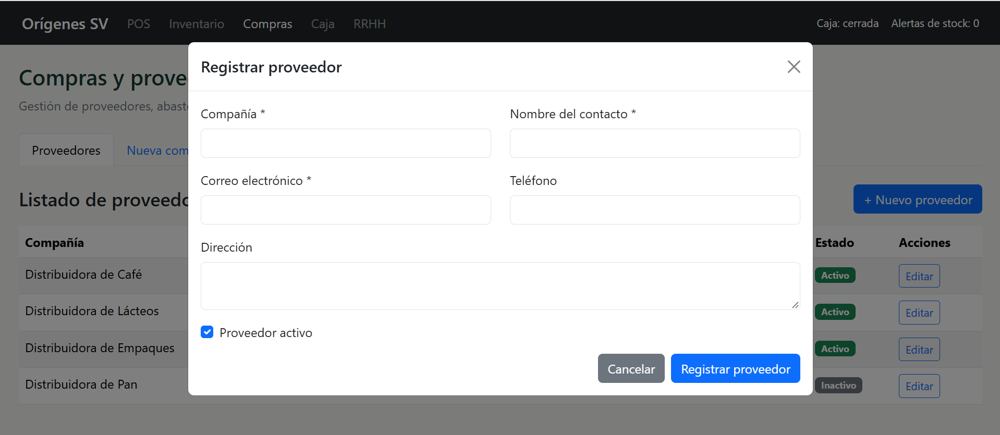

Figura 2. Formulario para registrar un nuevo proveedor.

### 15.3. Edición de proveedores

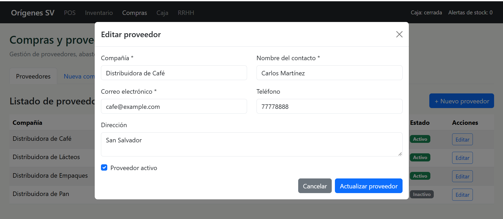

Figura 3. Formulario para actualizar la información de un proveedor existente.

### 15.4. Nueva compra

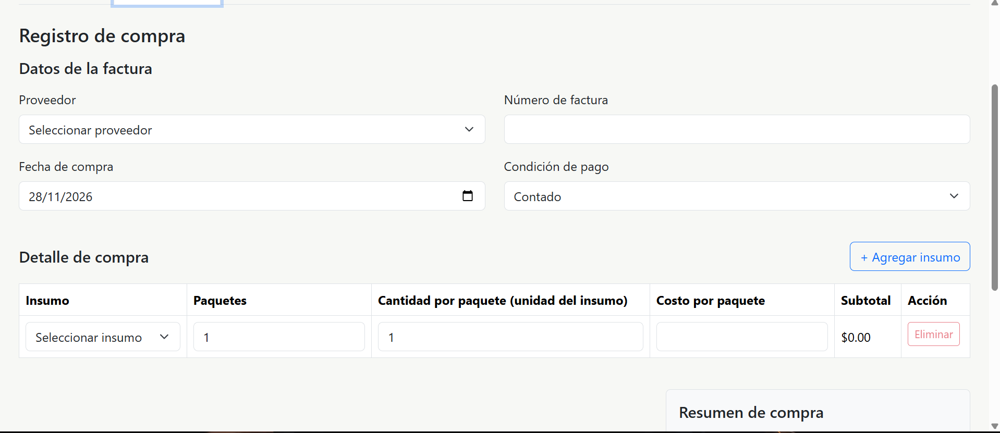

Figura 4. Formulario de registro de facturas de compra.

### 15.5. Compra al contado

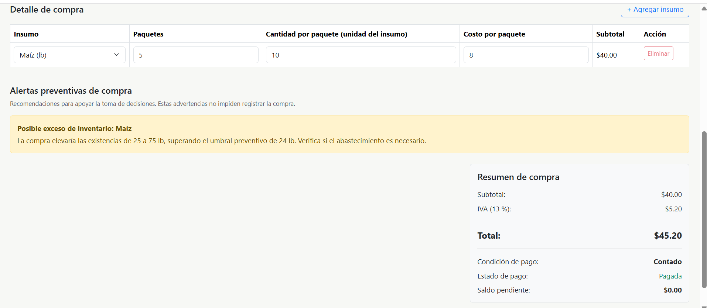

Figura 5. Registro de datos y cálculo de importes de una compra al contado.

### 15.6. Compra al crédito

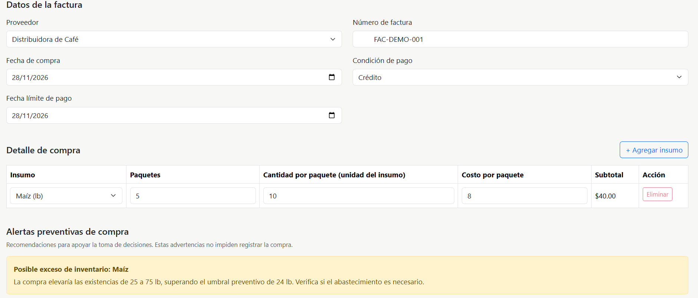

Figura 6. Selección de la condición de pago al crédito y fecha límite de pago.

### 15.7. Confirmación de compra

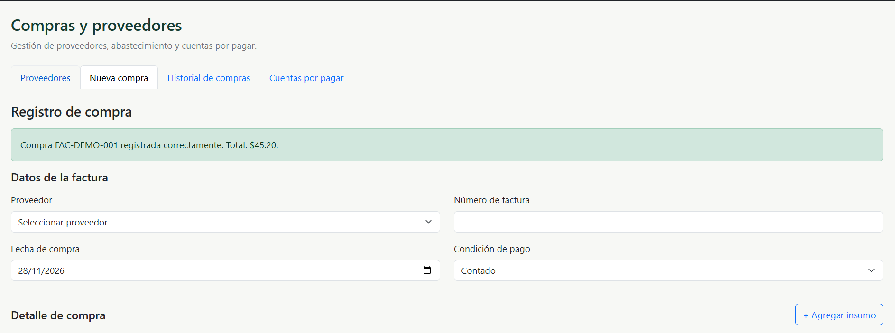

Figura 7. Mensaje de confirmación del registro de una compra.

### 15.8. Historial de compras

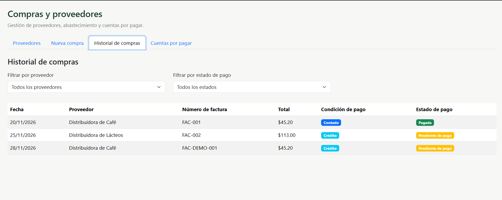

Figura 8. Consulta de las facturas registradas.

### 15.9. Filtros del historial

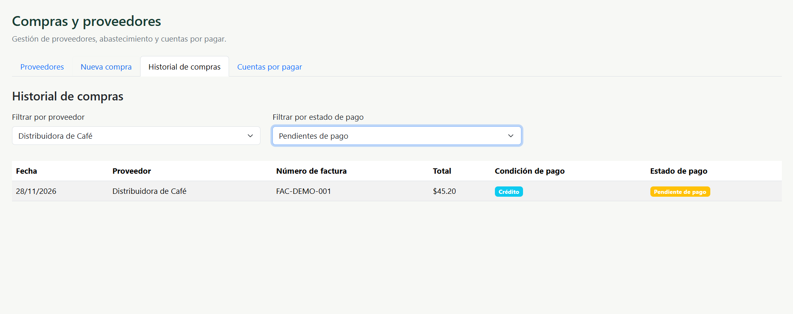

Figura 9. Aplicación de filtros por proveedor y estado de pago.

### 15.10. Cuentas por pagar

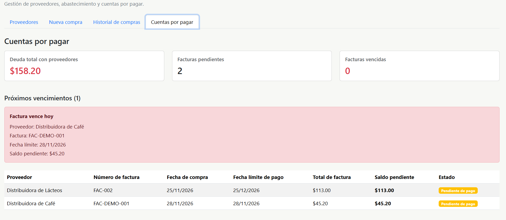

Figura 10. Indicadores financieros y obligaciones pendientes con proveedores.

### 15.11. Alertas preventivas de inventario

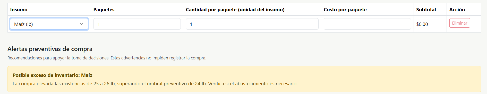

Figura 11. Advertencia preventiva relacionada con las existencias proyectadas.

### 15.12. Incremento de precios

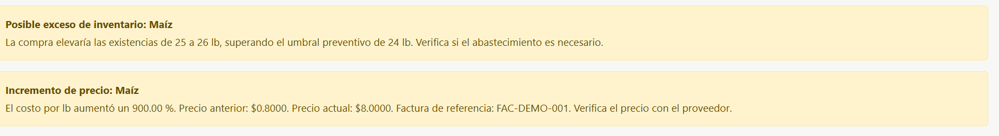

Figura 12. Advertencia generada mediante la comparación de costos unitarios históricos.

### 15.13. Próximos vencimientos

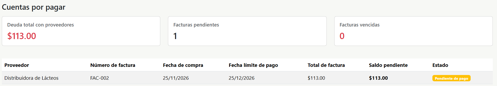

Figura 13. Alertas de facturas próximas a su fecha límite de pago.

### 15.14. Validaciones del formulario

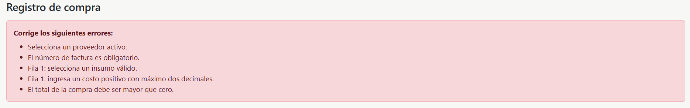

Figura 14. Mensajes de validación durante el registro de compras.

### 15.15. Diseño responsivo

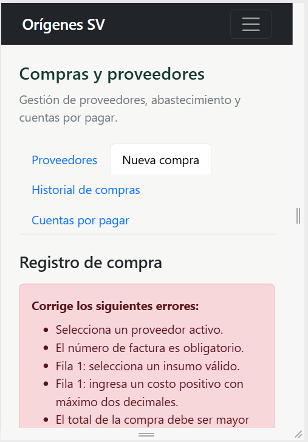

Figura 15. Adaptación de la interfaz del módulo a dispositivos móviles.

---

Fin del manual de usuario del módulo de Compras y Proveedores del sistema Restaurante Orígenes SV.